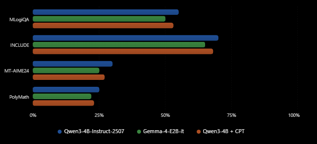
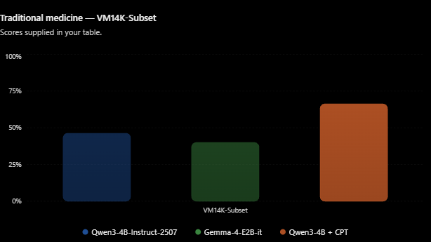

# Vietnamese general benchmark results — October 6, 2026

**Illustrative hypothetical performance—not measured results.**

| Model | Benchmark | score |
| --- | --- | ---: |
| Qwen3-4B-Instruct-2507 | MLogiQA (vi) | 55.0% |
| Qwen3-4B-Instruct-2507 | INCLUDE (vi) | 70.0% |
| Qwen3-4B-Instruct-2507 | MT-AIME24 (vi) | 30.0% |
| Qwen3-4B-Instruct-2507 | PolyMath (vi) | 25.0% |
| Gemma-4-E2B-it | MLogiQA (vi) | 50.0% |
| Gemma-4-E2B-it | INCLUDE (vi) | 65.0% |
| Gemma-4-E2B-it | MT-AIME24 (vi) | 25.0% |
| Gemma-4-E2B-it | PolyMath (vi) | 22.0% |
| Qwen3-4B + CPT | MLogiQA (vi) | 53.0% |
| Qwen3-4B + CPT | INCLUDE (vi) | 68.0% |
| Qwen3-4B + CPT | MT-AIME24 (vi) | 27.0% |
| Qwen3-4B + CPT | PolyMath (vi) | 23.0% |

| Model | Benchmark | Tradmed score |
| --- | --- | ---: |
| Qwen3-4B-Instruct-2507 | VM14K-Subset | 46.2% |
| Gemma-4-E2B-it | VM14K-Subset | 39.89% |
| Qwen3-4B + CPT | VM14K-Subset | 66.2% |

Qwen revision: `cdbee75f17c01a7cc42f958dc650907174af0554`.
The Qwen runner recorded 33 unparsed answers on MLogiQA, 8 on INCLUDE,
and 26 on MT-AIME24; these count as incorrect. Several multiple-choice
answers were printed as a first-line letter followed by an explanation,
which the original parser missed. That parser is fixed for future runs,
but the archived scores above remain unchanged. Many MT-AIME responses
end mid-solution at the token cap. The first 92 PolyMath rows
are an incomplete prefix, so they must not be reported as a benchmark score.

The job reloads weights at the start of each benchmark. Earlier logs therefore
show repeated weight loading even after a benchmark finishes. The runner now
logs model load completion and progress after each batch. A new launch is
required to finish the remaining model and benchmark runs.
